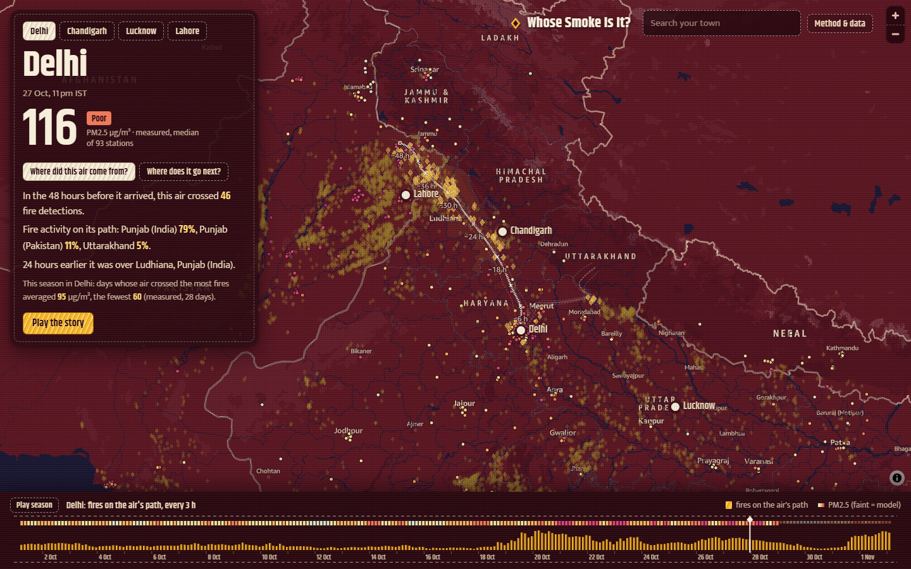
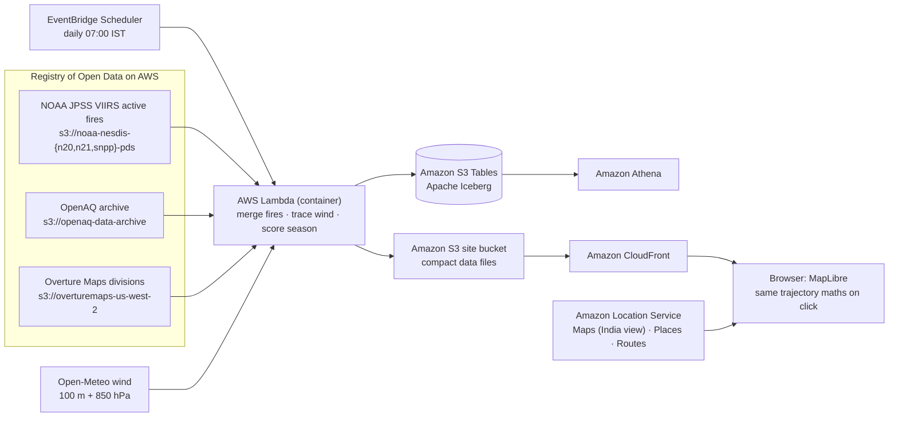

# Whose Smoke Is It?

**Trace the air any North Indian city is breathing back 48 hours along the real wind, and see the farm fires it crossed.**

Live map: **https://d1wlimk0cn6w6a.cloudfront.net** · Built for the AWS Builder Center *Map It* weekend challenge (Oct–Nov 2026).

Pick a city or search your own town, drag the season border to any hour since 1 October, or click anywhere. The map:

- sews the air back 48 hours through the hourly wind (a white running-stitch thread, with nine faint sibling threads showing the uncertainty);
- lights up every satellite-detected fire the air passed within 25 km of while it was burning (gold satin diamonds);
- names the districts and states that fire activity was in, and shows the PM2.5 measured when the air arrived;
- flips to **forward** mode: click any fire to see which towns its smoke drifts over in the next 48 hours, and how many people live there;
- plays a guided **story** (`?tour=1`) built from the data at load time.

## What the 2026 season shows (measured data, 1–28 Oct)

| City | Days with measured PM2.5 | PM2.5 on days the air crossed the most fires | …the fewest fires | Rank correlation | With season trend removed |
|---|---|---|---|---|---|
| Delhi | 28 | **95** µg/m³ | 60 | 0.69 | 0.43 |
| Lahore | 28 | **129** | 68 | 0.69 | 0.52 |
| Lucknow | 25 | **61** | 36 | 0.76 | 0.59 |
| Chandigarh | 25 | **31** | 22 | 0.61 | 0.65 |

- Fire activity on the paths of Delhi's air split almost evenly: **45% Punjab (India), 43% Punjab (Pakistan)**. 15% of Lahore's was in India's Punjab. Smoke crosses the border both ways.
- "Most" and "fewest" are the top and bottom quarter of measured days. Day-to-day changes in Delhi do *not* track fires closely (local traffic, industry and still air matter too); the link holds across the season, including after removing the trend that both fires and smog share as October gets colder.
- The map does not blame anyone. Farmers burn stubble because the window between the rice harvest and wheat sowing is short.

## How it works

| AWS service | What it does here | Why this one |
|---|---|---|
| **Amazon Location Service** | Basemap (Monochrome style, `political-view=IND`, re-dyed as cloth in the browser), place search (Autocomplete + GetPlace), reverse geocoding of fires and dropped pins, road distance and drive time from a fire to the city (CalculateRoutes) | One referrer-restricted API key serves maps, places and routes; India's official boundaries are a style parameter |
| **Registry of Open Data on AWS** | NOAA VIIRS fire granules, OpenAQ station archive, Overture divisions | All three are read directly from public S3 buckets with no API keys |
| **AWS Lambda** (container image, built by AWS CodeBuild into Amazon ECR) | Daily pipeline: ~1,000 fire granules per satellite per day filtered to the North India overpasses, 2.7k-point wind grid, 725 stations, 1,024 ensemble trajectories, district join with DuckDB spatial | h5py and DuckDB need a container; a full season rebuild takes ~5 minutes |
| **Amazon EventBridge Scheduler** | Runs the pipeline every morning after the night satellite pass is published | |
| **Amazon S3 Tables (Apache Iceberg)** | Tables `fires`, `stations`, `aq_hourly`, `exposure`, `district_share`, written through the S3 Tables Iceberg REST endpoint with pyiceberg; each run is a snapshot | Season data stays queryable and time-travellable without running a database |
| **Amazon Athena** | SQL over the Iceberg tables via the `s3tablescatalog` federated catalog; see [`infra/athena-queries.sql`](infra/athena-queries.sql) | |
| **Amazon S3 + Amazon CloudFront** | Static site with origin access control, strict CSP, gzip data files | |

### The trajectory model

`pipeline/smoke/trajectory.py` and its browser twin `web/src/traj.ts` integrate the hourly wind with a midpoint (RK2) scheme, 15-minute steps, bilinear in space and linear in time, as a 10-member ensemble (5 start offsets × 2 heights). A fire counts as crossed if a thread passes within 25 km from 3 h before the satellite saw it to 18 h after (crop residue smoulders). Repeat sightings of the same ~2 km cell in one overpass are merged. This is an indicative kinematic model, not a dispersion model like HYSPLIT: it shows where air came from, not how much smoke it carried.

Unit tests (`pipeline/tests/test_trajectory.py`) check zero wind, an analytic uniform-wind displacement, back-then-forward round trips (< 2 km over 48 h), leaving the grid, and the fire time window. The NOAA fire reader was checked against NASA FIRMS for the same satellite and day (304 vs 321 detections in the Punjab box on 28 Oct; the difference is persistent industrial hot spots, which are dropped).

### Data contract (what the browser loads)

| File | Content |
|---|---|
| `data/manifest.json` | days available, wind grid layout, trajectory parameters, cities with season summary, sources |
| `data/wind/YYYY-MM-DD.bin` | int16 little-endian `[24 h][2 levels][u,v][27 lat][41 lon]`, cm/s |
| `data/fires/YYYY-MM-DD.json` | columnar fires: lat, lon, FRP (MW), minutes after 00:00 UTC, satellites, district index |
| `data/exposure/<city>.json` | every 3 h: fires on path, FRP on path, measured and model PM2.5; season stats and leaderboards |
| `data/stations.json` | 725 stations with hourly PM2.5 |
| `data/districts.geojson`, `data/towns.json` | Overture districts (simplified) and towns with population |

## Reuse it for another smoky region

1. Edit `pipeline/smoke/config.py`: `REGION`, `GRID`, `CITIES`, `PASS_WINDOWS_UTC` (the satellites' local overpass hours for your longitude) and `COUNTRIES` in `geo.py`.
2. Deploy: `aws cloudformation deploy --template-file infra/build.yaml --stack-name whose-smoke-build --capabilities CAPABILITY_IAM`, upload `pipeline/` as `pipeline.zip` to the build bucket and start the CodeBuild project, then deploy `infra/template.yaml` with `IngestImageUri` set to the pushed image. The template creates the buckets, CloudFront distribution, Location API key, S3 Tables bucket, Athena workgroup, Lambda and schedule.
3. Run `infra/deploy-site.ps1` to build and publish the map, and invoke the Lambda once (`{"refresh_days": 3}`) to build the season. For Athena, create the `s3tablescatalog` federated catalog once per region (see the AWS S3 Tables integration guide).

Locally: `cd pipeline && python -m smoke.run --start 2026-10-01` writes the same files to `web/public/data`, then `cd web && npm install && npm run dev` (put `{"region": "...", "apiKey": "..."}` in `web/public/config.json`).

## Limits, honestly

- The newest few days show model PM2.5 (CAMS) until the OpenAQ archive publishes station data (~3 days).
- Satellites miss small fires and fires under cloud, so fire counts are a floor.
- Two wind levels on a 0.5° grid cannot resolve valley flows or the shallow night-time layer.
- Correlation is not cause. Fires are one source among traffic, industry, dust, festivals and still air.

## Data and licences

- NOAA JPSS VIIRS Active Fires (EFIRE EDR), public domain, via the Registry of Open Data on AWS.
- OpenAQ, via the Registry of Open Data on AWS (station data from CPCB, DPCC, state boards and others).
- Overture Maps Foundation divisions (ODbL; includes OpenStreetMap contributors), via the Registry of Open Data on AWS.
- Open-Meteo forecast and air-quality APIs (CC BY 4.0).
- Basemap © AWS, HERE via Amazon Location Service.

Code: MIT licence.
