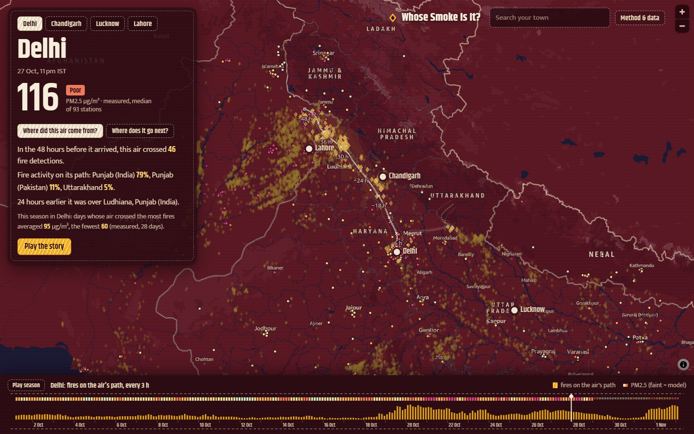

# Whose Smoke Is It? Tracing North India's air back to the fires it crossed

**Live map:** https://d1wlimk0cn6w6a.cloudfront.net
**Demo video (2:45):** <YouTube link>
**Code (MIT):** https://github.com/mahanteshimath/aws_map_it

Every October and November the air over Delhi turns grey, and the argument starts again: is it the farm fires in Punjab, or Delhi's own traffic and industry? Satellites can show you the fires. Air-quality stations can show you the smog. Neither tells you whether *the air you are breathing today* actually passed over those fires.

So I built a map that follows the air itself. Pick a city (or search your own town), pick any hour this season, and the map sews the air back 48 hours along the real wind, then lights up every satellite-detected fire it crossed.



## What you can explore

- **Where did this air come from?** A white running-stitch thread traces the air back hour by hour, with nine faint sibling threads (two heights, five start points) so you can see how certain the path is. Fires it passed within 25 km of while burning light up as gold diamonds, sized by fire radiative power.
- **Who was it over?** The plaque names the fire activity on the path by state and province, and where the air was 24 hours earlier ("over Mansa, Punjab (India)").
- **Where does this smoke go?** Click any fire. Amazon Location Service reverse-geocodes it ("near Tahli, Dasua"), routes the road distance to the city ("452 km, 5 h 46 min of driving; the air covered it in about 33 hours"), and one click traces its smoke *forward*. The tour follows one field in Gujranwala whose next 48 hours of wind carry its smoke over 61 towns where 40.5 million people live.
- **The season border.** The embroidered strip along the bottom is every 3-hourly trace since 1 October: gold columns for fires on the air's path, a coloured thread for PM2.5 (India's AQI bands, faint where it is a model estimate). Drag it, or press *Play season*.
- **Any place, any hour.** Click anywhere on the map: the same trajectory maths runs in the browser on the published wind grid, and the nearest air-quality station reports what was measured.
- **Play the story.** A guided tour whose every number is chosen from the data at load time.

## What it reveals

Across 28 days of **measured** PM2.5 (OpenAQ, 93 stations in Delhi):

| City | PM2.5 when the air crossed the most fires | …the fewest | Rank correlation | With season trend removed |
|---|---|---|---|---|
| Delhi | **95** µg/m³ | 60 | 0.69 | 0.43 |
| Lahore | **129** | 68 | 0.69 | 0.52 |
| Lucknow | **61** | 36 | 0.76 | 0.59 |
| Chandigarh | **31** | 22 | 0.61 | 0.65 |

Two things surprised me:

1. **Smoke crosses the border both ways.** Of the fire activity on Delhi's air paths this season, 45% was in India's Punjab and 43% in Pakistan's Punjab. For Lahore, 15% was in India's Punjab. One plain, one sky.
2. **Fires explain the season, not every day.** The link survives removing the October trend that fires and smog share, but day-to-day changes in Delhi barely track fires: still air, traffic, industry and festivals matter too. The map is honest about that; it shows one piece of the story.

The map blames no one. Farmers burn stubble because the window between the rice harvest and wheat sowing is short; the map just shows where the air travelled.

## The datasets

| Dataset | What is in it | Where it comes from |
|---|---|---|
| **NOAA JPSS VIIRS Active Fires (EFIRE EDR)** | Every fire pixel seen by NOAA-20, NOAA-21 and Suomi NPP: location, fire radiative power, day/night. ~1,000 global granules per satellite per day | Registry of Open Data on AWS: `s3://noaa-nesdis-{n20,n21,snpp}-pds` |
| **OpenAQ archive** | Hourly PM2.5 from 725 stations in the region (CPCB, DPCC, state boards, others) | Registry of Open Data on AWS: `s3://openaq-data-archive` |
| **Overture Maps divisions** | 407 district boundaries and 787 towns with population, India and Pakistan | Registry of Open Data on AWS: `s3://overturemaps-us-west-2` |
| **Open-Meteo wind and CAMS PM2.5** | Hourly wind at 100 m and 850 hPa on a 0.5° grid; model PM2.5 for the last few days | open-meteo.com (CC BY 4.0) |

Season so far: 35,490 fire detections after merging repeat sightings, 362,826 hourly PM2.5 readings, 1,024 ensemble trajectories.

## How it gets onto the map

**1. Fires straight from S3.** The Lambda lists each satellite's day, keeps only granules in the afternoon and night overpass windows for North India, reads the HDF5 fire arrays with h5py, crops to the region, drops persistent industrial hot spots, and merges repeat sightings of the same ~2 km cell. (Validated against NASA FIRMS for the same satellite and day: 304 vs 321 detections in the Punjab box.)

**2. Tracing the wind.** A midpoint (RK2) integrator steps every 15 minutes through the hourly wind, bilinear in space and linear in time, for a 10-member ensemble. A fire counts as crossed if a thread passes within 25 km from 3 h before the satellite saw it until 18 h after. It is an indicative kinematic model, not a dispersion model, and the map says so.

**3. Scoring the season.** For each preset city, every 3 hours: fires on the path, which districts they were in (DuckDB spatial join on Overture boundaries), and the measured PM2.5 when the air arrived. Then rank correlation, with and without the season trend.

**4. Publishing.** Compact files for the browser (int16 wind grids, columnar fire JSON) go to S3 behind CloudFront. The same season goes to Apache Iceberg tables.

**5. The map.** MapLibre GL draws Amazon Location Service's Monochrome basemap in India's political view, re-dyed in the browser as a phulkari cloth (maroon handspun ground, indigo rivers). The trajectory code is mirrored in TypeScript, so clicking anywhere gives the same answer as the pipeline.

## Why these AWS services, and how the pieces fit

```
Registry of Open Data on AWS (NOAA fires, OpenAQ, Overture)  +  Open-Meteo wind
        │
        ▼
EventBridge Scheduler (07:00 IST) ──► AWS Lambda container (built by CodeBuild → ECR)
        │                                   │
        │                                   ├──► Amazon S3 Tables (Apache Iceberg) ──► Amazon Athena
        │                                   └──► Amazon S3 site bucket ──► Amazon CloudFront
        ▼
Browser (MapLibre)  ◄──  Amazon Location Service: Maps (India view) · Places · Routes
```

- **Amazon Location Service** does four jobs from one referrer-restricted API key: the basemap with `political-view=IND` (India's official boundaries matter for an Indian audience), place search (Autocomplete + GetPlace), reverse geocoding of fires and dropped pins, and CalculateRoutes for the road distance from a fire to the city, which makes the scale of the smoke's journey intuitive. Place results are shown live and never stored.
- **Registry of Open Data on AWS** means no API keys and no copying: the Lambda reads NOAA, OpenAQ and Overture directly from their public buckets.
- **AWS Lambda as a container** because the pipeline needs h5py and DuckDB spatial. I built the image in **AWS CodeBuild** (my laptop cannot run Docker), pushed to **Amazon ECR**. A full season rebuild takes about 5 minutes.
- **Amazon S3 Tables (Apache Iceberg)** hold `fires`, `stations`, `aq_hourly`, `exposure` and `district_share`, written through the S3 Tables Iceberg REST endpoint with pyiceberg. Every daily run is a new snapshot, so you can time-travel the season.
- **Amazon Athena** queries them through the `s3tablescatalog` federated catalog, for example this season leaderboard:

```sql
SELECT region, name AS district, round(100 * share, 1) AS pct
FROM "s3tablescatalog/whose-smoke-lake"."air"."district_share"
WHERE city = 'delhi' ORDER BY share DESC LIMIT 5;
-- PK-PB Lahore Division 17.2 · IN-PB Tarn Taran 16.3 · PK-PB Gujrat Division 10.7 · …
```

- **Amazon S3 + CloudFront** serve the static map with origin access control and a strict content security policy.

Everything is one CloudFormation (SAM) template plus a small build stack, in `infra/`.

## Reuse the pattern

The approach works for any smoke-affected place where satellites see fires and stations measure air: California or Canada wildfire season, Southeast Asian haze, the Amazon burning season. Edit one config file (region, grid, cities, satellite overpass hours), deploy the template, invoke the Lambda once. The README has the steps and the data contract.

## Limits

- The newest ~3 days show model PM2.5 until station data is published.
- Satellites miss small fires and fires under cloud: counts are a floor.
- Two wind levels on a 0.5° grid cannot resolve every valley flow or the shallow night-time layer.
- Correlation is not cause.

*Data: NOAA JPSS VIIRS (public domain), OpenAQ, Overture Maps Foundation (ODbL), Open-Meteo (CC BY 4.0). Basemap © AWS, HERE.*
